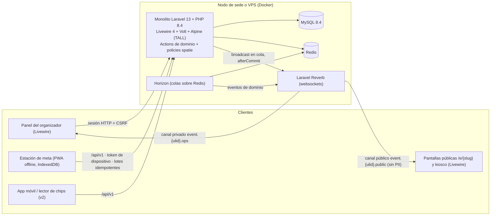
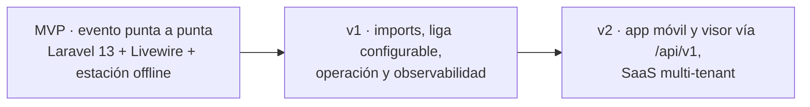
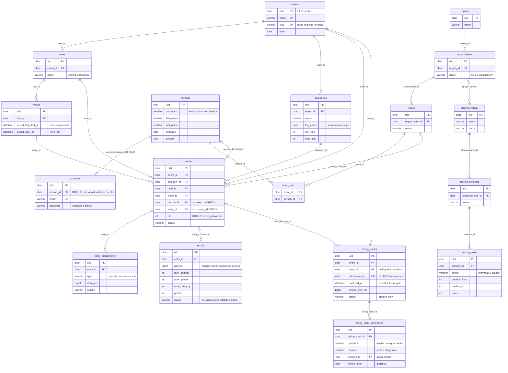

# TDChronos 2.0 — Sistema de cronometraje, resultados y liga de carreras

> Documento de entrega del proyecto final (Entrega 1). La especificación completa del sistema (PRD, SRS, ADRs, backlog, DoD, invariantes, pruebas y roadmap) vive en [spec/README.md](spec/README.md); los prompts del curso, en [prompts.md](prompts.md).
> **Autores:** Oscar Ramon Lobo Altuve (oscarescalando@gmail.com) · Gabriel Toro (gabrieltoro77@gmail.com).

## Índice

0. [Ficha del proyecto](#0-ficha-del-proyecto)
1. [Descripción general del producto](#1-descripción-general-del-producto)
2. [Arquitectura del sistema](#2-arquitectura-del-sistema)
3. [Modelo de datos](#3-modelo-de-datos)
4. [Especificación de la API](#4-especificación-de-la-api)
5. [Historias de usuario](#5-historias-de-usuario)
6. [Tickets de trabajo](#6-tickets-de-trabajo)
7. [Pull requests](#7-pull-requests)

---

## 0. Ficha del proyecto

### **0.1. Tu nombre completo:**

- Ing. Oscar Ramon Lobo Altuve — oscarescalando@gmail.com
- Gabriel Toro — gabrieltoro77@gmail.com

### **0.2. Nombre del proyecto:**

TDChronos 2.0 — sistema de cronometraje, resultados en vivo y liga de carreras de calle, trail y obstáculos (OCR).

### **0.3. Descripción breve del proyecto:**

TDChronos 2.0 es la plataforma con la que una organización de cronometraje opera sus eventos: configura el evento con carreras/distancias, categorías por rango de edad y salidas por oleadas; gestiona el directorio de personas, cuentas y equipos; inscribe atletas y equipos con asignación de dorsales (alta individual, de equipo o importación XLSX); registra las llegadas en meta con una estación de cronometraje offline instalable como PWA; corrige marcas con confirmación, motivo y auditoría; publica la clasificación en vivo y oficial; y administra la liga por puntos entre clubes con esquemas de puntos configurables en base de datos.

Es una reconstrucción completa desde cero sobre **Laravel 13 + Livewire 4 (stack TALL) + Laravel Reverb**, con tres compromisos de producto: **integridad de los tiempos** (marcas append-only e idempotentes, cero marcas perdidas o duplicadas), **privacidad de los atletas** (cero datos personales en superficies públicas) y **operación en sede sin Internet** (estación de meta offline con sincronización posterior). La base de datos se crea íntegramente con migraciones y seeders de datos sintéticos, con usuarios nuevos (admin bootstrap incluido); no se conecta ni migra ningún dato de versiones anteriores.

### **0.4. URL del proyecto:**

https://github.com/oscarescalando/AI4Devs-finalproject

### 0.5. URL o archivo comprimido del repositorio

- Repositorio: https://github.com/oscarescalando/AI4Devs-finalproject (rama `feature/entrega-1-ol-gt`)
- Especificación del sistema: [spec/README.md](spec/README.md) · Prompts: [prompts.md](prompts.md)

---

## 1. Descripción general del producto

### **1.1. Objetivo:**

Dar a organizadores y cronometradores una plataforma que garantice la **integridad de los tiempos y la privacidad de los atletas**:

- Cero marcas perdidas o duplicadas, incluso con cortes de red o de servicios (invariantes INV-02, INV-08 e INV-12 de [spec/06-invariantes.md](spec/06-invariantes.md)).
- Cero datos personales (documento, fecha de nacimiento) en superficies públicas (INV-06).
- Operación completa en sede **sin Internet** (nodo local) con estación de meta offline.
- Clasificación en vivo en menos de 2 segundos desde la marca hasta la pantalla.
- Base mantenible y verificable: stack con soporte, monolito modular con decisiones registradas como ADRs ([spec/03-arquitectura/](spec/03-arquitectura/README.md)), cobertura ≥ 80 % en el dominio crítico y CI como condición de merge ([spec/07-tests.md](spec/07-tests.md)).

**¿Para quién?** Organizadores (montar y publicar eventos), cronometradores (operar la meta), jueces (corregir marcas con constancia), oficiales de salida, atletas (ver su tiempo y posición), clubes que compiten en liga y administración técnica. Siete personas de usuario definidas en el PRD ([spec/01-prd.md](spec/01-prd.md) §3).

### **1.2. Características y funcionalidades principales:**

- **Eventos y configuración**: fases del evento, carreras/distancias, categorías por rango de edad (individual/equipo) con recategorización en lote y previsualización, oleadas con reprogramación en bloque y hora programada + real.
- **Directorio**: organizaciones/clubes y regiones, personas y cuentas separadas (persona ≠ cuenta) con roles e invitaciones, equipos con miembros y detección de duplicados.
- **Inscripciones y dorsales**: alta individual y de equipo con unicidad persona-evento, ajustes acumulables de penalización/bonificación, asignación automática de dorsal, importación XLSX con previsualización e informe de filas rechazadas, planillas PDF de inscripción (dompdf).
- **Salida**: check-in con contadores en vivo, salidas por oleada con deshacer sin sobrescribir la hora programada.
- **Cronometraje offline**: estación de meta instalable como PWA, captura local en IndexedDB (< 50 ms), Enter sin dorsal = marca huérfana, sincronización idempotente por lotes, reloj con desfase corregido y doble estación de respaldo.
- **Correcciones auditadas**: marcas inmutables (append-only), bitácora en vivo, reasignación/ajuste/anulación con motivo, previsualización y reversión.
- **Clasificación y resultados**: cálculo en el servidor (posiciones general/categoría/género con `RANK()` en job), leaderboard en vivo por deltas < 2 s, pantallas públicas sin login y sin datos personales, modo kiosco y publicación de resultados oficiales.
- **Liga configurable**: campeonatos y esquemas de puntos en base de datos (cero IDs en código), tabla pública de standings.
- **Tiempo real**: Reverb con canales por evento (público sin PII y privado operativo), payloads versionados con `seq` y resincronización, degradación a polling si el websocket cae — la marca nunca falla por un fallo de broadcast.
- **Operación**: panel de salud (cola, Reverb, backups), backups cifrados automáticos, runbook, logs estructurados y métricas.
- **Acceso**: menú y botones generados desde los permisos reales del servidor (spatie/laravel-permission), tokens de dispositivo para estaciones y 2FA para administración (v2).

Detalle completo por requisito: [spec/02-srs.md](spec/02-srs.md) §3 (RF) y §4 (RNF).

### **1.3. Diseño y experiencia de usuario:**

La interfaz es **TALL (Livewire 4 + Volt + Alpine.js + Blade)** servida por el monolito, sin SPA. Dieciocho componentes Livewire cubren las 14 pantallas del panel más 4 nuevas (estación de meta, publicación de resultados, asistente de importación y panel de salud); el catálogo pantalla ↔ componente está en [spec/02-srs.md](spec/02-srs.md) §6.1.

Navegación por evento: `/events/{ulid}/{configuracion|inscripciones|salida|meta|bitacora|resultados}`; pantallas públicas bajo `/e/{slug}/…`.

Principios de experiencia:

- Estación de meta **solo con teclado** (dorsal + Enter), feedback por color, icono y sonido (verde asignada, ámbar duplicada, roja desconocida, gris pendiente de sincronizar), tipografía grande y legible a la intemperie.
- **Estados de conexión visibles** en toda pantalla en vivo: «En vivo», «Reconectando…», «Sin conexión (N pendientes)».
- Validación **en el servidor** con todos los errores a la vez y foco en el primero; mensajes en español claro que indican qué hacer; nada de overlays bloqueantes.
- Confirmación explícita con previsualización en acciones masivas o irreversibles (recalcular categorías, reasignar marca, publicar resultados).
- Pantallas públicas sin login, responsive de móvil 360 px a TV 4K, con modo kiosco y branding por evento.
- Tiempos `h:mm:ss` con soporte > 24 h y décimas opcionales; fechas `dd/mm/aaaa`; zona horaria del evento (`America/Caracas`).
- Accesibilidad WCAG 2.1 AA; historial de cambios a un clic desde cualquier inscripción o marca.

Capturas y videotutorial: se adjuntarán con el MVP de la nueva interfaz.

### **1.4. Instrucciones de instalación:**

**Requisitos:** PHP 8.4+, Composer, MySQL 8.4, Redis y Node 20+ (build Vite). Recomendado Docker + Docker Compose.

**Arranque limpio (el sistema nace de migraciones):**

1. Clonar el repositorio y entrar: `git clone https://github.com/oscarescalando/AI4Devs-finalproject && cd AI4Devs-finalproject`.
2. `composer install && npm install`.
3. `cp .env.example .env` y configurar las credenciales locales de MySQL, Redis y Reverb.
4. `php artisan key:generate`.
5. `php artisan migrate --seed` — crea la base de datos **desde cero** con las migraciones versionadas y la puebla con **datos sintéticos** (seeders); crea los **usuarios nuevos**, incluido el admin bootstrap.
6. `npm run dev` (desarrollo) o `npm run build`, y `docker compose up -d` para el stack completo: app, MySQL 8.4, Redis, Reverb y Horizon (RNF-25).

> **Nota importante:** **NO se migra ninguna conexión ni dato de versiones anteriores.** La base de datos nace vacía de las migraciones y se puebla con seeders sintéticos; no existen datos reales de personas en el repositorio. Reglas de oro completas en [spec/README.md](spec/README.md) §4.

**Estado:** el código se construye por épicas ([spec/04-backlog/](spec/04-backlog/README.md)) siguiendo el roadmap ([spec/08-roadmap.md](spec/08-roadmap.md)); estas instrucciones describen el arranque limpio objetivo del nuevo sistema.

---

## 2. Arquitectura del Sistema

### **2.1. Diagrama de arquitectura:**



**Patrón elegido: monolito modular con UI en el servidor (TALL) y API solo para consumidores no-web** (ADR-010, ADR-011, ADR-012 en [spec/03-arquitectura/](spec/03-arquitectura/README.md)).

Justificación: equipo pequeño (2 personas) y un dominio donde la operación en sede manda. Se descartó una SPA desacoplada por sus costos conocidos — doble validación, autorización decidida en el cliente y un segundo stack que mantener (ADR-011). Livewire mantiene la reactividad (websockets) con validación y permisos siempre en el servidor, y un único despliegue simplifica el nodo de sede sin Internet.

Beneficios: un solo lenguaje y despliegue; superficie de API mínima (menos que proteger); pruebas de arquitectura que obligan al flujo Livewire → Actions; operación local sencilla con Docker. Sacrificios: la reactividad fina de tablas grandes puede exigir `wire:poll` o deltas (riesgo R10 del PRD, con prototipo temprano y plan B declarados, [spec/01-prd.md](spec/01-prd.md) §8); curva de aprendizaje del equipo con Livewire (riesgo R11, mitigada con el ADR-011 como guía y un kit de componentes CRUD); la estación offline exige un componente local Alpine + IndexedDB fuera del ciclo Livewire (ADR-014, espiga técnica obligatoria en F1).

### **2.2. Descripción de componentes principales:**

| Componente | Tecnología | Responsabilidad |
|---|---|---|
| Aplicación | Laravel 13 / PHP 8.4 | Monolito modular: rutas web (Livewire), API `/api/v1`, Actions de dominio, policies spatie (teams = evento), PDF con dompdf |
| UI | Livewire 4 + Volt + Alpine.js + Blade | 18 componentes (panel, públicas, estación); validación en servidor; `wire:loading`; WCAG 2.1 AA |
| Tiempo real | Laravel Reverb | Canales `event.{ulid}.public` (solo lectura, sin PII) y `event.{ulid}.ops` (privado); broadcast en cola con `afterCommit`; contrato versionado `v`/`seq` con resincronización |
| Datos | MySQL 8.4 + Redis | Esquema íntegro con FKs físicas, UNIQUE y CHECK; ULID públicos; tiempos en milisegundos. Redis para colas y caché |
| Procesos | Horizon + scheduler | Cálculo de resultados, broadcast, exportaciones e importaciones en colas |
| API pública | `/api/v1` (Sanctum tokens con abilities) | REST JSON para la estación, app móvil (v2), visor (v2) e integraciones; OpenAPI 3.1 generada con Scramble y publicada en `/docs/api` |
| Estación offline | PWA (service worker + IndexedDB) | Captura local < 50 ms con `client_mark_id`, sincronización idempotente por lotes, reloj con desfase corregido |
| Calidad | Pest, Larastan 8, Pint, Pest Arch, Playwright, gitleaks, k6 | Cobertura ≥ 80 % en dominios críticos, análisis estático, E2E, escaneo de secretos, pruebas de carga ([spec/07-tests.md](spec/07-tests.md)) |
| Infraestructura | Docker Compose + Caddy | Servicios: app, MySQL, Redis, Reverb, Horizon (dev, nodo de sede y VPS) |

### **2.3. Descripción de alto nivel del proyecto y estructura de ficheros**

Estructura objetivo del nuevo repositorio (monolito modular):

```text
tdchronos2/
├── app/
│   ├── Actions/            # lógica de dominio: única puerta desde Livewire y desde la API
│   ├── Livewire/           # componentes por área: Dashboard, Events, Directory, Timing, Public, Imports, Admin
│   ├── Models/             # Eloquent: persons, accounts, events, races, waves, categories, entries,
│   │                       #   timing_marks, timing_mark_corrections, results, championships…
│   ├── Policies/           # autorización por recurso y por evento
│   ├── Events/             # eventos de dominio → broadcast en cola (afterCommit)
│   └── Jobs/               # resultados, broadcast, exportaciones, importaciones
├── database/migrations/    # esquema íntegro versionado: la BD nace aquí, sin datos heredados
├── lang/es                 # UI en español
├── resources/views/        # layouts Blade + vistas Livewire (sin JavaScript de aplicación)
├── routes/                 # web.php (panel y públicas) · api.php (/api/v1)
├── tests/                  # Unit, Feature, Arch (Pest) y Browser (Playwright)
├── docker/                 # compose para dev, nodo de sede y VPS (Caddy)
└── docs/                   # OpenAPI publicada y documentación viva
```

Patrón: componente Livewire (o endpoint de la API) → **Action** de dominio → Models/BD → evento de dominio → broadcast en cola. La UI no contiene lógica de negocio ni consume una API propia (ADR-011/ADR-012); el cálculo de resultados y las posiciones viven en jobs del servidor, nunca en el cliente. Las reglas de arquitectura se verifican automáticamente con Pest Arch ([spec/07-tests.md](spec/07-tests.md) §2.3).

### **2.4. Infraestructura y despliegue**



- **Entorno local y nodo de sede**: `docker compose up` (app, MySQL 8.4, Redis, Reverb, Horizon) detrás de Caddy. El nodo de sede es un portátil o mini-PC con UPS y router propios en la LAN del evento; funciona sin Internet.
- **CI** (obligatoria para mergear): Pint → Larastan nivel 8 → Pest con cobertura ≥ 80 % en dominio crítico → pruebas de arquitectura (Pest Arch) → gitleaks → `composer audit` → Playwright `smoke` → build de la imagen Docker ([spec/07-tests.md](spec/07-tests.md) §3).
- **Despliegue**: por Pull Request con la checklist de la Definition of Done (criterios G1–G15, [spec/05-dod.md](spec/05-dod.md)); merge solo con CI en verde. En este repositorio de entregas: rama `feature/entrega-N` → PR a `main`.
- **Fases** ([spec/08-roadmap.md](spec/08-roadmap.md)): MVP de evento punta a punta → v1 con importaciones, liga configurable y operación → v2 como plataforma SaaS multi-tenant (fase posterior, ADR-016). **La migración de datos históricos está fuera de alcance**: la base de datos nace de migraciones desde cero (enmienda a ADR-015, 2026-10-20).

### **2.5. Seguridad**

- **Autorización en el servidor**: roles y permisos en base de datos (spatie/laravel-permission, teams = evento) más policies por recurso; matriz rol × acción probada automáticamente; 401/403 con semántica correcta. El menú y los botones solo reflejan permisos reales del servidor (INV-14).
- **Sin datos personales en superficies públicas**: ningún listado de personas sin sesión; pantallas, endpoints y canales públicos solo con DTOs sin documento, nacimiento, email ni teléfono; enmascarado en listados; exportaciones con PII auditadas (INV-06).
- **Autenticación**: sesión Laravel (cookie HttpOnly + SameSite), bloqueo por intentos, contraseñas Argon2id/bcrypt sin valores por defecto, tokens Sanctum con abilities solo para dispositivos y estaciones, 2FA para administración (v2).
- **Superficie de API mínima** con rate limiting (lectura pública 120/min/IP, escritura 60/min/cuenta, marcas sin límite por estación autenticada) y ordenación con lista blanca.
- **Cero secretos en el repositorio**: gitleaks en CI, `.env.example` con marcadores, seeders solo con datos sintéticos (INV-13).
- **Auditoría inmutable**: registro de marcas, correcciones, cambios de estado, cambios de rol y exportaciones (quién, cuándo, antes/después, IP/estación) (INV-11).
- **Integridad**: transacciones atómicas en marcas, resultados y cierres; FKs físicas, UNIQUE y CHECK en la base (INV-09); broadcast con `afterCommit` para que un fallo de Reverb nunca afecte la marca (INV-08).
- **Archivos** con nombre UUID (nunca el documento de identidad) y subida multipart con límites.

Invariantes y verificación: [spec/06-invariantes.md](spec/06-invariantes.md).

### **2.6. Tests**

- **Unit/Feature con Pest**: cobertura ≥ 80 % en Timing, Results y Registration; casos borde de cada caso de uso (G2, G3).
- **Pruebas de arquitectura** (Pest Arch): Livewire → Actions, límites de módulo y prohibiciones de los ADRs (G5).
- **E2E con Playwright** (ADR-018): suite `smoke` por rol en CI, suite `cu-paridad` sobre los 26 casos de uso y suite nocturna `estacion-offline` (G12).
- **Pruebas de caos**: broker detenido (la marca responde 200), red intermitente cada 30 s, 500 marcas offline, doble estación; criterio: 0 marcas perdidas y 0 duplicadas.
- **Carga con k6**: ≥ 200 espectadores conectados con delta < 2 s p95; 60 marcas/min por estación con 4 estaciones simultáneas.
- **Transversal**: Larastan 8, Pint, gitleaks, `composer audit` y una prueba automática de ausencia de PII en respuestas públicas.

Estrategia completa (pirámide, suites, gates de CI y trazabilidad prueba ↔ requisito/HU/épica/invariante): [spec/07-tests.md](spec/07-tests.md).

---

## 3. Modelo de Datos

### **3.1. Diagrama del modelo de datos:**

Modelo to-be canónico definido en [spec/02-srs.md](spec/02-srs.md) §5.1 y [spec/03-arquitectura/ADR-015-modelo-datos.md](spec/03-arquitectura/ADR-015-modelo-datos.md) (con la enmienda de arranque limpio de 2026-10-20). **La base de datos nace íntegramente de migraciones versionadas**: `php artisan migrate:fresh --seed` deja un entorno demo utilizable, con seeders sintéticos y usuarios nuevos.



Principios estructurales del modelo (detalle en [spec/02-srs.md](spec/02-srs.md) §5.1 y [spec/06-invariantes.md](spec/06-invariantes.md)):

- **Persona ≠ cuenta**: `persons` (atleta) y `accounts` (acceso) con `accounts.person_id` UNIQUE.
- **Marcas inmutables**: `timing_marks` append-only + `timing_mark_corrections` auditadas (INV-01, INV-11).
- **Resultados derivados**: `results` se calcula desde marcas + oleadas + ajustes; nada se edita a mano (INV-07).
- **Ajustes como filas acumulables**: `entry_adjustments` (penalización/bonificación).
- **Oleadas con hora programada y real**: `waves.scheduled_start_at` + `waves.actual_start_at`.
- **Liga configurable**: `championships` + `scoring_schemes` + `scoring_rules` — cero IDs en código.
- **Integridad en la base de datos**: FKs físicas, `UNIQUE (event_id, bib)` y `(event_id, person_id)`, `CHECK` persona xor equipo (INV-03, INV-04, INV-05, INV-09).
- **Identificadores**: PK `bigint unsigned` + **ULID** `char(26)` público; `client_mark_id` UUIDv7.
- **Tiempo en milisegundos**: `datetime(3)` instantes, `bigint` ms duraciones, soporte > 24 h (INV-10).

### **3.2. Descripción de entidades principales:**

| Entidad (tabla) | Qué representa | Atributos y restricciones clave | Relaciones |
|---|---|---|---|
| `events` | Evento del calendario | `ulid` público, `name` UNIQUE, `slug` UNIQUE (rutas públicas), `date` | Padre de carreras, categorías, oleadas, inscripciones y marcas |
| `persons` + `accounts` | Atleta (persona) y su cuenta de acceso | `accounts.person_id` UNIQUE; documento enmascarado en listados; contraseña Argon2id/bcrypt | 1:1 entre persona y cuenta; 1:N con inscripciones individuales |
| `organizations` + `regions` | Club/organización y su región | `name`, `region_id` | 1:N con equipos; N:M con campeonatos (liga) |
| `teams` + `team_user` | Equipo y sus miembros | Membresía con par `(team_id, person_id)` | N:1 con organizaciones; 1:N con inscripciones de equipo |
| `races` | Carrera/distancia del evento | `event_id`, `name` | 1:N con oleadas e inscripciones |
| `waves` | Oleada de salida | `scheduled_start_at` (programada) y `actual_start_at` (real) | N:1 con carreras; 1:N con inscripciones |
| `categories` | Categoría por rango de edad | `for_teams` (individual/equipo), `min_age`, `max_age`; recategorización en lote con previsualización | N:1 con eventos; 1:N con inscripciones |
| `entries` | Inscripción con dorsal | `person_id` **xor** `team_id` (CHECK); `UNIQUE (event_id, bib)` y `(event_id, person_id)`; `status` | Núcleo transaccional; 1:N con ajustes, marcas y resultados |
| `entry_adjustments` | Ajustes acumulables | `type` (penalty/bonus/historical), `delta_ms`, `reason` | N:1 con inscripciones |
| `timing_marks` | Marca de meta (append-only) | `client_mark_id` UUIDv7 UNIQUE (idempotencia); `captured_at` con offset corregido; `entry_id` null = huérfana | Solo inserciones (INV-01); 1:N con correcciones |
| `timing_mark_corrections` | Corrección auditada | `operation` (ajustar/reasignar/anular), `reason` obligatorio, auditoría antes/después con quién, cuándo e IP/estación | N:1 con marcas |
| `results` | Resultado derivado | `net_ms`, posiciones general/género/categoría, puntos; calculado en job con `RANK()`, nunca editado a mano | N:1 con inscripciones |
| `championships` + `scoring_schemes` + `scoring_rules` | Liga configurable | Esquemas y reglas de puntos en base de datos (rangos de posición → puntos, por individual/equipo) | N:1 encadenadas; N:M con organizaciones vía standings |

Tablas de soporte: roles/permisos spatie (`model_has_roles` con `team_id = event_id`), `activity_log`, `import_batches`/`import_rows`, `exports`, `personal_access_tokens`, `sessions`, `jobs`/`failed_jobs`.

---

## 4. Especificación de la API

La UI web **no consume la API**: los componentes Livewire invocan las Actions del dominio (ADR-012, [spec/03-arquitectura/ADR-012-api-solo-no-web.md](spec/03-arquitectura/ADR-012-api-solo-no-web.md)). La API `/api/v1` existe para consumidores no-web: la estación de cronometraje, la app móvil y el visor de llegadas (v2) e integraciones. REST JSON, OpenAPI 3.1 generada con Scramble y publicada en `/docs/api`; errores `application/problem+json`; identificadores ULID; paginación por cursor; tokens Sanctum con abilities para dispositivos. Contrato completo: [spec/02-srs.md](spec/02-srs.md) §5.3 y §6.

Los tres endpoints principales, en formato OpenAPI:

```yaml
openapi: 3.1.0
info:
  title: TDChronos API v1
  version: 1.0.0
servers:
  - url: https://{host}/api/v1
    variables:
      host: { default: localhost }
paths:
  /time:
    get:
      summary: Hora oficial del servidor (referencia para el offset de la estación)
      security: []
      responses:
        "200":
          description: Instante del servidor
          content:
            application/json:
              schema:
                type: object
                properties:
                  server_ms: { type: integer, example: 1761000000123 }
                  timezone: { type: string, example: America/Caracas }
  /public/events/{eventId}/leaderboard:
    get:
      summary: Clasificación en vivo del evento (pública, sin datos personales)
      description: >
        Sin autenticación y cacheable. Solo nombre, organización, categoría,
        tiempos netos y posiciones; jamás documento, nacimiento ni contacto (RNF-13).
      security: []
      parameters:
        - { name: eventId, in: path, required: true, schema: { type: string, example: 01JARQ3M9X } }
        - { name: categoryId, in: query, schema: { type: string } }
        - { name: gender, in: query, schema: { type: string, enum: [M, F, X] } }
        - { name: cursor, in: query, schema: { type: string } }
      responses:
        "200":
          description: Página de la clasificación con versión y secuencia para resync
          content:
            application/json:
              schema:
                type: object
                properties:
                  v: { type: integer, example: 1 }
                  seq: { type: integer, example: 4213 }
                  rows:
                    type: array
                    items:
                      type: object
                      properties:
                        bib: { type: integer, example: 128 }
                        name: { type: string, example: Ana Pérez }
                        org: { type: string, example: Club Zulianos }
                        race: { type: string, example: 21K }
                        category: { type: string, example: F 30-39 }
                        net_ms: { type: integer, example: 5432000 }
                        ranks:
                          type: object
                          properties:
                            general: { type: integer, example: 12 }
                            gender: { type: integer, example: 3 }
                            category: { type: integer, example: 1 }
  /events/{eventId}/timing-marks:
    post:
      summary: Registro de marcas por lotes (idempotente)
      description: >
        Endpoint de la estación de meta y de lectores de chip. Cada marca lleva
        client_mark_id (UUIDv7): reenviar el mismo lote nunca duplica. Resultado
        por marca: assigned / orphan / duplicate. Token de dispositivo con
        ability device:marks; sin límite de tasa para estaciones autenticadas.
      security: [{ deviceToken: [] }]
      parameters:
        - { name: eventId, in: path, required: true, schema: { type: string } }
      requestBody:
        required: true
        content:
          application/json:
            example:
              marks:
                - client_mark_id: 018f6d2e-7c1a-7a2e-9f3b-1c2d3e4f5a6b
                  bib: 128
                  device_time_ms: 1761000000123
                  clock_offset_ms: -320
                  source: station
                - client_mark_id: 018f6d2e-7c1a-7a2e-9f3b-1c2d3e4f5a6c
                  bib: null
                  device_time_ms: 1761000005450
                  clock_offset_ms: -320
                  source: station
      responses:
        "200":
          description: Resultado por marca
          content:
            application/json:
              example:
                results:
                  - client_mark_id: 018f6d2e-7c1a-7a2e-9f3b-1c2d3e4f5a6b
                    status: assigned
                    entry_id: 01JARQ5ZK2
                    net_ms: 5432000
                  - client_mark_id: 018f6d2e-7c1a-7a2e-9f3b-1c2d3e4f5a6c
                    status: orphan
        "401": { description: Token inválido o revocado (la cola local de la estación se conserva) }
components:
  securitySchemes:
    deviceToken:
      type: http
      scheme: bearer
      description: Token Sanctum de dispositivo con abilities (p. ej. device:marks)
```

---

## 5. Historias de Usuario

Historias completas (HU-01…HU-52, con prioridad y RF/épica asociados): [spec/01-prd.md](spec/01-prd.md) §4 · Backlog por épica: [spec/04-backlog/](spec/04-backlog/README.md).

**Historia de Usuario 1 — Estación de meta que funciona sin Internet (HU-47, Must)**

Como **cronometrador**, quiero la estación de meta instalada como app en la tablet que **funcione sin Internet** (captura local y sincronización automática al volver), para no perder una sola marca si se cae la red.

- *Flujo principal:* abro la PWA instalada (emparejada una sola vez con un token de dispositivo) → se cae la red de la sede → tecleo dorsal + Enter y veo la confirmación verde en < 50 ms → Enter sin dorsal crea una marca huérfana → vuelve la red y la cola se sincroniza por lotes sin duplicados; los indicadores de pendientes y desfase de reloj están siempre visibles.
- *Criterios de aceptación:* con la red desconectada se registran ≥ 500 marcas y no se pierde ninguna al recargar o cerrar el navegador; captura local < 50 ms; reenvío del mismo `client_mark_id` no duplica; Enter vacío crea huérfana sin teclear «0»; alerta si el desfase del reloj supera 1 s.
- *Ref.:* RF-41, RF-82, RNF-01/RNF-04 · épicas EP-08 (dominio de cronometraje) y EP-27 (estación offline).

**Historia de Usuario 2 — Clasificación en vivo sin iniciar sesión (HU-52, Must)**

Como **espectador**, quiero la **pantalla de clasificación en vivo sin iniciar sesión**, para seguirla desde el móvil o la TV del evento.

- *Flujo principal:* escaneo el QR del evento → `/e/{slug}/…` carga la clasificación con filtros por categoría, género y distancia → cada llegada resalta la fila en menos de 2 segundos sin recargar la página → puedo verla a pantalla completa (modo kiosco).
- *Criterios de aceptación:* accesible sin sesión y sin ningún dato personal en el payload (prueba automática de ausencia de documento/nacimiento/email/teléfono); delta < 2 s con ≥ 200 clientes conectados; posiciones calculadas en el backend y coincidentes con el resultado oficial al cerrar.
- *Ref.:* RF-51, RF-52, RF-80 · épicas EP-09/EP-11 (dominio y tiempo real); pantalla ISSUE-137 en EP-25.

**Historia de Usuario 3 — Corrección de marcas con constancia (HU-49, Must)**

Como **juez**, quiero corregir una marca (ajustar hora, reasignar, anular) **con confirmación, motivo y auditoría**, para dejar constancia y poder revertir.

- *Flujo principal:* en la bitácora en vivo selecciono la marca dudosa → elijo la acción → el sistema muestra previsualización (y confirmación extra si el dorsal destino ya tiene llegada) → escribo el motivo y confirmo → la marca original conserva su valor (append-only) y la corrección queda en la línea de tiempo de la inscripción.
- *Criterios de aceptación:* la hora original del cronómetro nunca se pierde; toda corrección registra quién, cuándo, antes/después e IP/estación; la reasignación a un dorsal con llegada exige confirmación explícita; cualquier corrección puede revertirse.
- *Ref.:* RF-46…RF-50, RF-84 · épicas EP-08 (dominio) y EP-25 (pantallas de bitácora y corrección).

---

## 6. Tickets de trabajo

**Ticket 1 (backend) — ISSUE-149: Sincronización idempotente de marcas por lotes**

| Tipo | Prioridad | Estimación | Labels | Depende de |
|---|---|---|---|---|
| feature | P0 | M (≤ 5 días) | `api`, `offline`, `cronometraje`, `rebuild` | ISSUE-148 (captura IndexedDB), ISSUE-067 (API de marcas, backlog heredado) |

*Descripción.* Cliente de sincronización de la estación contra `POST /api/v1/events/{e}/timing-marks`: lotes de hasta 100 marcas, idempotencia por `client_mark_id` (reenviar nunca duplica), resultado por marca (`assigned` / `orphan` / `duplicate`), reintento con backoff ante fallos y sincronización en segundo plano con disparo manual forzado. Indicadores permanentes de conexión, pendientes y última sincronización.

*Criterios de aceptación*

- Reenvío del mismo `client_mark_id` devuelve el mismo resultado sin duplicar (prueba de idempotencia de extremo a extremo).
- Con red intermitente (caída cada 30 s), la cola local se drena completa al volver, sin duplicados ni pérdidas (prueba automatizada).
- La app sigue capturando mientras sincroniza; ninguna sincronización bloquea el teclado.
- El resultado por marca actualiza la lista local y el roster en caché.
- Token revocado → mensaje claro y cola local preservada (nada se descarta por un 401/403).

Definición completa: [spec/04-backlog/EP-27-estacion-offline-pwa.md](spec/04-backlog/EP-27-estacion-offline-pwa.md).

**Ticket 2 (frontend) — ISSUE-137: Pantalla de clasificación en vivo (proyección) en Livewire**

| Tipo | Prioridad | Estimación | Labels | Depende de |
|---|---|---|---|---|
| feature | P0 | L (≤ 10 días) | `frontend`, `livewire`, `clasificacion`, `tiempo-real`, `rebuild` | ISSUE-074 (motor de resultados, backlog heredado), ISSUE-142 (puente Echo) |

*Descripción.* Pantalla de proyección de la clasificación en vivo: fondo oscuro, branding del evento, reloj, filtros, columna de diferencia, filas DSQ, resaltado de llegadas ≤ 30 s y modo pantalla completa. Decisiones de diseño: posiciones y diferencia calculadas en el backend, cero código dinámico en el cliente, endpoint y payload sin datos personales, y actualización por delta del canal del evento en < 2 s.

*Criterios de aceptación*

- Posiciones, diferencia y tiempo neto provienen del backend y coinciden con el cálculo oficial al cerrar (prueba de conciliación).
- Ningún `eval` ni código dinámico en cliente (chequeo estático en CI).
- Vista accesible sin sesión con solo datos sin PII (prueba de ausencia de documento/nacimiento/email/teléfono).
- Una llegada se refleja en < 2 s aplicando delta, sin recargar la colección (medición con 1.000 inscritos).
- Proyección de 4 h sin degradación de memoria ni listeners huérfanos.

Definición completa: [spec/04-backlog/EP-25-pantallas-livewire.md](spec/04-backlog/EP-25-pantallas-livewire.md).

**Ticket 3 (fundaciones) — ISSUE-105: Esqueleto Laravel 13 / PHP 8.4 y base de datos por migraciones**

| Tipo | Prioridad | Estimación | Labels | Depende de |
|---|---|---|---|---|
| chore | P0 | M (≤ 5 días) | `chore`, `backend`, `rebuild`, `architecture` | — |

*Descripción.* Proyecto nuevo desde cero (no un fork de código previo): monolito modular Laravel 13 + PHP 8.4 con los módulos de dominio y el modelo de datos to-be ([spec/03-arquitectura/ADR-015-modelo-datos.md](spec/03-arquitectura/ADR-015-modelo-datos.md)): persona ≠ cuenta, marcas append-only, resultados derivados, tiempos en milisegundos, identificadores públicos ULID. La base de datos se crea **íntegramente con migraciones versionadas**; los seeders cargan datos sintéticos y crean los usuarios nuevos (admin bootstrap incluido); sin conexión ni migración de datos heredados (enmienda ADR-015, 2026-10-20).

*Criterios de aceptación*

- Laravel 13, PHP ≥ 8.4, `declare(strict_types=1)`, Pint y Larastan 8 en CI.
- Módulos de dominio con un ejemplo mínimo verificable (health check) y reglas de dependencia entre módulos probadas (Pest Arch).
- Zona horaria `America/Caracas`, MySQL `utf8mb4`, tiempos con precisión de milisegundos donde aplique.
- IDs públicos ULID con route model binding; los IDs enteros nunca salen al exterior.
- README de arranque en ≤ 5 comandos; `php artisan migrate:fresh --seed` produce un entorno demo utilizable (usuarios nuevos, datos sintéticos).
- Reversibilidad de las migraciones probada en la PR (criterio G6 de la DoD).

Definición completa: [spec/04-backlog/EP-24-fundaciones-livewire.md](spec/04-backlog/EP-24-fundaciones-livewire.md).

---

## 7. Pull requests

**Política (GitHub):** una rama `feature/entrega-N-<iniciales>` por entrega en este repositorio, integrada a `main` por PR; el código del sistema seguirá la misma política, una PR por épica. Toda PR debe cumplir la Definition of Done (criterios G1–G15, [spec/05-dod.md](spec/05-dod.md)): criterios de la issue verificados E2E, pruebas nuevas pasando, cobertura ≥ 80 % en dominio crítico, Larastan 8 y Pint limpios, migraciones reversibles, revisión de PII, gitleaks verde, documentación/OpenAPI actualizada y, si cambia la UX de meta, prueba con un cronometrador real. Merge solo con CI en verde ([spec/07-tests.md](spec/07-tests.md) §3).

**Pull Request 1 — Entrega 1: documentación del proyecto**

- Rama: `feature/entrega-1-ol-gt` → `main` (este repositorio)
- Contenido: `readme.md` (este documento), `prompts.md` y la carpeta `spec/` completa
- Estado: por abrir

**Pull Request 2 — Fundaciones del nuevo sistema (épica EP-24)**

- Contenido previsto: esqueleto Laravel 13 + PHP 8.4 con base de datos por migraciones y seeders sintéticos ([ISSUE-105](spec/04-backlog/EP-24-fundaciones-livewire.md)), Docker/CI, autenticación por sesiones, roles y permisos spatie con matriz de políticas probada, esqueleto Livewire con menú por permisos reales y Reverb operativo con pruebas de fallo.
- Estado: planificada

**Pull Request 3 — Estación de cronometraje offline (épica EP-27)**

- Contenido previsto: shell PWA, captura en IndexedDB con `client_mark_id`, sincronización idempotente por lotes, reloj con offset y suite de caos con 0 marcas perdidas ([spec/04-backlog/EP-27-estacion-offline-pwa.md](spec/04-backlog/EP-27-estacion-offline-pwa.md)).
- Estado: planificada
