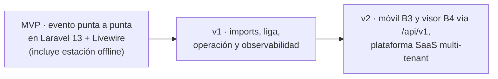

# 01 — PRD — TDChronos 2.0 (Laravel 13 + Livewire)

> **Fecha:** 2026-10-19 · **Estado:** vigente · Documento de especificación de TDChronos 2.0.
> Requisito a requisito en [02-srs.md](02-srs.md); decisiones de stack en **ADR-010…016 (ver [03-arquitectura/](03-arquitectura/))**.
> Enmienda ADR-015 (2026-10-20): arranque limpio — base de datos nueva creada íntegramente por migraciones desde cero;
> seeders con datos sintéticos; usuarios nuevos (admin bootstrap + seeders); sin conexión ni migración de datos heredados.

## Índice

1. [Problema y oportunidad](#1-problema-y-oportunidad)
2. [Visión del producto y objetivos](#2-visión-del-producto-y-objetivos)
3. [Usuarios y personas](#3-usuarios-y-personas)
4. [Alcance](#4-alcance)
5. [Métricas de éxito](#5-métricas-de-éxito)
6. [Experiencia de usuario](#6-experiencia-de-usuario)
7. [Plan de releases](#7-plan-de-releases)
8. [Riesgos y mitigaciones](#8-riesgos-y-mitigaciones)
9. [Supuestos y dependencias](#9-supuestos-y-dependencias)
10. [Preguntas abiertas](#10-preguntas-abiertas)

---

## 1. Problema y oportunidad

La organización de cronometraje cronometra carreras de trail, obstáculos, ultras y acuatlones y necesita una plataforma
que responda en las condiciones reales de la sede: ráfagas de llegadas en la meta, redes de sede inestables, picos de
espectadores en línea y jornadas que se deciden por segundos. En concreto, la organización necesita:

1. **Integridad de los tiempos garantizada en el peor momento.** Toda pulsación de la estación debe convertirse en una
   marca persistida y auditada, aunque caiga la red o un servicio en tiempo real; las marcas sin dorsal y las
   correcciones deben resolverse con historial completo e inmutable.
2. **Privacidad de los datos personales.** Ninguna superficie pública debe exponer documento, fecha de nacimiento ni
   contacto de los atletas; ningún secreto en el repositorio; ningún dato real de personas en el código ni en las
   semillas de la base de datos.
3. **Operación diaria sin fricciones.** Alta y edición de cuentas e inscripciones de punta a punta; edad de
   competencia correcta; recálculos de categorías transaccionales, previsualizables y reversibles.
4. **Escala y mantenibilidad.** Un stack moderno con soporte, pruebas y CI; actualizaciones de clasificación por delta
   (sin recargar la clasificación completa en cada llegada); el cálculo siempre en el servidor; la liga configurable
   desde la consola, sin tocar código.
5. **Autonomía de la base de datos.** Un esquema propio, con contrato claro frente a sistemas externos, que permita
   evolucionar cada pieza sin riesgos cruzados.

**Oportunidad:** TDChronos 2.0 — una reconstrucción limpia desde cero, con el alcance funcional completo (77 RF) sobre
**Laravel 13 + Livewire (TALL) + Reverb** — sin SPA que mantener, con validación y permisos siempre en el servidor, y
una estación de cronometraje que funciona sin Internet — garantizando la integridad de los tiempos, la privacidad y la
operación en sede. La base de datos se crea íntegramente con migraciones y seeders de datos sintéticos. Tras el núcleo
se añade lo que hoy se gestiona a mano (importaciones, liga configurable, resultados oficiales publicables) y, como
fase posterior, la plataforma SaaS multi-organizador (app móvil B3 y visor B4 vía `/api/v1`).

## 2. Visión del producto y objetivos

### 2.1 Objetivos

| # | Objetivo | Cómo se mide |
|---|---|---|
| O1 | **Cero marcas perdidas o duplicadas**, incluso con cortes de red o de servicios | Pruebas de caos + 0 incidencias en los 3 primeros eventos reales |
| O2 | **Cero PII en superficies públicas** y ningún secreto en el repositorio | Prueba automática de respuestas públicas + gitleaks en CI |
| O3 | **Paridad funcional** del alcance (77 RF, operable en la nueva UI) | Checklist de paridad firmado por el organizador |
| O4 | **Clasificación en vivo < 2 s** desde la marca hasta la pantalla, con ≥ 200 espectadores | Prueba de carga (RNF-03) |
| O5 | **Operable sin Internet** en la sede con un nodo local | Evento simulado sin WAN |
| O6 | **Mantenible:** stack con soporte, pruebas y CI | Cobertura ≥ 80 % en dominios críticos, pipeline verde |
| O7 | **Fuera de alcance (enmienda ADR-015, 2026-10-20: arranque limpio sin datos heredados).** Re-puntado a: **base de datos nueva creada íntegramente por migraciones + seeders sintéticos verificables** | `php artisan migrate:fresh --seed` deja el sistema operativo; seeders revisados sin datos reales de personas |
| **O8** | **Interfaz construida en Livewire con paridad de uso**: los 26 casos de uso (CU-01…26) operables en la nueva UI TALL con **≤ 5 desviaciones aceptadas y documentadas** | Checklist CU-01…26 ejecutado por el organizador; registro de desviaciones con justificación y aprobación (p. ej., flujo distinto de corrección de marcas por RF-84) |

### 2.2 No-objetivos

- **Migración de datos históricos: fuera de alcance** (enmienda ADR-015, 2026-10-20). Base de datos nueva creada
  íntegramente por migraciones desde cero; seeders con datos sintéticos; usuarios nuevos (admin bootstrap + seeders);
  sin conexión ni migración de datos heredados.
- Inscripción pública con pago en línea (pregunta abierta Q1; por defecto fuera del MVP).
- Cronometraje por chip RFID como fuente de tiempo (v2).
- **App móvil nativa en el núcleo**: llega en v2 como bloque **B3** vía `/api/v1`; la estación de meta y las pantallas
  públicas son web/PWA (Livewire).
- **Sin SPA web propia**: el bloque **B2 del diseño de plataforma (Nuxt 3) queda sustituido** por Livewire (ADR-011);
  toda la UI web es servidor-renderizada con reactividad Livewire + Reverb.
- Multi-organización SaaS con facturación: fase posterior (ADR-016); el núcleo deja preparado el ámbito por evento
  (spatie teams) y el branding.
- Puntos de control intermedios o parciales (modelo preparado, no implementado).

## 3. Usuarios y personas

Las **7 personas** del producto, con su mapeo a roles spatie/policies y pantallas Livewire:

| Persona | Contexto y necesidad principal | Rol spatie (ámbito) | Pantallas Livewire |
|---|---|---|---|
| **Olga, organizadora** | Monta 3-6 eventos/año; necesita configurar rápido, importar inscritos, publicar resultados y administrar la liga sin depender de un programador | `organizer` (sus eventos) | `Dashboard`, `Events\EventForm`, `EntriesManager`, `Imports\Wizard`, `Events\ResultsPublish` |
| **Carlos, cronometrador** | En la meta, sol/lluvia, WiFi inestable; teclear dorsales en ráfaga sin perder ninguna, con o sin red | `timekeeper` (su evento) | `Timing\Station` (PWA offline, solo teclado) |
| **Julia, jueza** | Revisa marcas dudosas y aplica penalizaciones; reasignar con seguridad y dejar constancia auditada | `official` (su evento) | `Events\MarksLog` (bitácora + correcciones RF-84) |
| **Samuel, oficial de salida** | Pasa lista y da la salida por oleada, con contadores reales en vivo | `official` (su evento, permiso de salidas) | `Events\StartList` |
| **Ana, atleta** | Corre 1-3 eventos/año; ver tiempo y posición en el móvil, sin necesidad de crear cuenta | sin cuenta / `athlete` | `Public\Leaderboard`, `Public\Results` (portal v2) |
| **Pedro, capitán de box** | Compite en liga con su club; tabla justa y al día | sin sesión (público) | `Public\Standings` |
| **Ramón, administrador técnico** | Mantiene la plataforma; desplegar con confianza, con backups, alertas y observabilidad | `admin` / `superadmin` | `Admin\HealthPanel`, `Directory\*`, `Championships\*` |

Regla transversal (HU-48): lo que cada persona ve en el menú y los botones lo decide el **servidor** (policies +
spatie teams por evento); la UI solo lo refleja.

## 4. Alcance

Prioridad **MoSCoW**: M = Must (MVP) · S = Should (v1) · C = Could (v2) · W = Won't. Las **46 historias del alcance
funcional** (HU-01…HU-46, con su texto completo, prioridad y RF/issue asociados en el corpus de origen) se resumen aquí
por módulo; los RF citados corresponden a [02-srs.md §3](02-srs.md#3-requisitos-funcionales).

| Módulo | HU | Conteo (M/S/C) | RF cubiertos |
|---|---|---|---|
| 4.1 Eventos y configuración | HU-01…HU-06 | 6 (4/1/1) | RF-01…RF-06, RF-07…RF-14 |
| 4.2 Directorio | HU-07…HU-11 | 5 (4/1/0) | RF-17…RF-24, RNF-13 |
| 4.3 Inscripciones y dorsales | HU-12…HU-18 | 7 (6/1/0) | RF-08…RF-10, RF-26…RF-31, RF-35, RF-64, RF-65, RF-67 |
| 4.4 Salida | HU-19…HU-21 | 3 (2/1/0) | RF-13…RF-16, RF-33 |
| 4.5 Cronometraje | HU-22…HU-27 | 6 (4/1/1) | RF-37…RF-44, RF-40, RF-41 |
| 4.6 Correcciones | HU-28…HU-33 | 6 (5/1/0) | RF-32, RF-33, RF-45…RF-50 |
| 4.7 Clasificación y resultados | HU-34…HU-38 | 5 (4/1/0) | RF-51…RF-60, RF-76 |
| 4.8 Liga | HU-39…HU-41 | 3 (0/2/1) | RF-57, RF-61…RF-63 |
| 4.9 Acceso y administración | HU-42…HU-46 | 5 (3/1/1) | RF-22, RF-68…RF-73, RNF-24 |
| **Interfaz Livewire (nuevo)** | **HU-47…HU-52** | **6 (4/2/0)** | **RF-78…RF-86** |

### Historias nuevas de la decisión Livewire/Reverb (continúan numeración)

| ID | Historia | Prio | RF / Épica |
|---|---|---|---|
| HU-47 | Como **cronometrador**, quiero la estación de meta instalada como app en la tablet que **funcione sin Internet** (captura local y sincronización automática al volver), para no perder una sola marca si se cae la red. | M | RF-41, RF-82, RNF-04, RNF-29 · EP-08, EP-27 |
| HU-48 | Como **organizador**, quiero que el menú y los botones reflejen mis **permisos reales del servidor**, para no descubrir con un 403 lo que no puedo hacer (ni que nadie lo intente). | M | RF-69, RF-79 · EP-04, EP-24 |
| HU-49 | Como **juez**, quiero corregir una marca (ajustar hora, reasignar, anular) **con confirmación, motivo y auditoría**, para dejar constancia y poder revertir. | M | RF-46…RF-48, RF-50, RF-84 · EP-08 |
| HU-50 | Como **organizador**, quiero generar la **planilla PDF de inscripción** con la plantilla de mi evento, para entregar constancias. | S | RF-36, RF-85 · EP-07 |
| HU-51 | Como **operador**, quiero importar un XLSX y ver **qué filas se rechazaron y por qué**, para corregir solo los errores y no repetir toda la carga. | S | RF-64…RF-66, RF-86 · EP-12 |
| HU-52 | Como **espectador**, quiero la **pantalla de clasificación en vivo sin iniciar sesión**, para seguirla desde el móvil o la TV del evento. | M | RF-51, RF-52, RF-80 · EP-09, EP-11, EP-26 |

## 5. Métricas de éxito

Métricas de éxito del nuevo sistema:

| Métrica | Meta |
|---|---|
| Marcas perdidas o duplicadas por evento | **0** (incluido corte de red de 10 min en el ensayo) |
| Latencia de la marca (tecla → confirmación local) | < 50 ms captura local; < 300 ms p95 confirmada |
| Latencia de la marca a la pantalla pública | < 2 s p95 con ≥ 200 espectadores |
| Marcas sin asignar (sin dorsal) sin resolver al publicar | 0 al publicar; resolución media < 2 min |
| Tiempo de configuración de un evento repetido | < 30 min (clonado + importación) |
| Última llegada → resultados oficiales publicados | < 30 min |
| Endpoints públicos con PII | 0 |
| Secretos o PII en el repositorio | 0 (gitleaks en CI) |
| Cobertura de pruebas en Timing/Results/Registration | ≥ 80 % |
| Base de datos recreable desde cero | `migrate:fresh --seed` operativo, seeders 100 % sintéticos |
| Incidencias críticas en los 3 primeros eventos | 0 P0 |
| Satisfacción de los operadores (encuesta 1-5) | ≥ 4 |

Métrica complementaria de O8: **desviaciones de paridad CU-01…26 ≤ 5, todas aceptadas y documentadas** en el registro
de desviaciones (revisión con el organizador al cierre del MVP).

## 6. Experiencia de usuario

Requisitos UX, adaptados al stack TALL (Livewire 4 + Volt + Alpine + Reverb):

1. **Estación de meta (PWA Livewire):** pantalla dedicada, alto contraste, tipografía grande, **solo teclado** —
   dorsal + Enter, Enter vacío = huérfana, atajos de observación (RF-82). Feedback inequívoco por color, icono y
   sonido: verde asignada, ámbar duplicada, rojo desconocida, gris pendiente de sincronizar. Contador de pendientes y
   desfase de reloj siempre visibles. Legible en exterior. Instalable (service worker) desde Chrome en tablet Android.
2. **Estados de conexión visibles** en toda pantalla en vivo: «En vivo» (Reverb conectado), «Reconectando…»,
   «Sin conexión (N pendientes)». Degradación automática a `wire:poll` (10-30 s) si el WebSocket cae.
3. **Nada de overlays que bloqueen** ante un error. `wire:loading` en toda acción (RF-81); mensajes en español claro
   que indiquen qué hacer: «El dorsal 123 ya tiene llegada a las 08:12:05. ¿Registrar como duplicada?».
4. **Confirmación explícita en acciones masivas o irreversibles** con previsualización: recalcular categorías,
   reprogramar oleadas, publicar resultados, reasignar una marca a un dorsal con llegada (RF-84).
5. **Pantallas públicas sin login**, responsive (móvil 360 px → TV 4K), modo kiosco con estilos aislados (layout
   público Blade, sin contaminar el panel), URLs compartibles con filtros y branding del evento (RF-05).
6. **Navegación por evento:** `/events/{ulid}/{configuracion|inscripciones|salida|meta|bitacora|resultados}` con panel
   de evento como inicio (`Dashboard\EventIndex`); públicas bajo `/e/{slug}/…`.
7. **Formularios:** validación **en el servidor** con todos los errores a la vez, foco en el primero (RF-78); labels
   asociados; autocompletados con `debounce` en componentes Livewire; nunca reglas duplicadas solo en el cliente.
8. **Tiempos:** formato `h:mm:ss` con soporte > 24 h (`54:05:34`) y décimas opcionales; fechas `dd/mm/aaaa`; zona
   horaria del evento (`America/Caracas`).
9. **Accesibilidad WCAG 2.1 AA** (RNF-20, RNF-28) en el panel y la estación; `lang="es"`; foco gestionado tras cada
   actualización Livewire.
10. **Historial siempre a un clic** desde una inscripción o una marca (`activity_log`, línea de tiempo RF-50).

## 7. Plan de releases

Alineado con el [08-roadmap.md](08-roadmap.md) (F1…F4), con la UI Livewire dentro del MVP:

| Release | Contenido | Criterio de salida |
|---|---|---|
| **MVP — evento punta a punta con Livewire** | Fundaciones (EP-03, EP-24), identidad y permisos spatie (EP-04), configuración (EP-05), directorio (EP-06), inscripciones (EP-07), **cronometraje offline con estación PWA (EP-08, EP-27, RF-82)**, resultados y cierre (EP-09), tiempo real con Reverb (EP-11, EP-26), operación mínima (EP-14: logs, backups, runbook), interfaz Livewire transversal (RF-78…RF-86) | Ensayo completo con 300 inscritos, 4 estaciones, corte de red de 10 min y **0 marcas perdidas**; paridad CU-01…26 con ≤ 5 desviaciones documentadas; primer evento real pequeño operado con el sistema nuevo |
| **v1 — completar y operar** | Importaciones (EP-12, RF-86), liga configurable (EP-10), branding (RF-05), duplicados (RF-24), dorsales automáticos (RF-29), exportaciones (RF-67), pruebas de carga (RNF-02/03), retención, métricas y observabilidad (RNF-24) | v1 completa en operación: importaciones, liga y exportaciones activas; prueba de carga superada; observabilidad activa |
| **v2 — plataforma** | App móvil **B3** y visor de llegadas **B4** sobre `/api/v1` (EP-20…EP-22 de plataforma), SaaS multi-tenant: planes, pagos, portal (EP-15…EP-19, EP-23; ADR-016), 2FA (RF-73), chips (RF-44), fotos de meta (RF-43), diplomas, liga individual (RF-63), portal del atleta (RF-25), clonado (RF-06) | Según prioridades del negocio; hoja de ruta de plataforma del corpus de origen (fase posterior) |

## 8. Riesgos y mitigaciones

| # | Riesgo | Prob. | Impacto | Mitigación |
|---|---|---|---|---|
| R1 | Un evento real del calendario cae antes de tener el MVP completo | Media | Alto | MVP estricto con prioridad en el camino crítico; runbook con `BROADCAST_DRIVER=log` como plan B; coordinar calendario (roadmap §4) |
| R2 | La estación offline introduce errores de reloj (dispositivos desincronizados) | Media | Alto | Offset tipo NTP contra `GET /time`, alerta de desfase, hora del servidor como referencia, doble estación, pruebas de caos |
| R3 | Diferencias de resultados al recalcular tras una corrección | Media | Medio | Resultados publicados versionados e inmutables (`result_publications`); recálculo determinista; diferencias documentadas |
| R4 | Dependencia de un sistema externo de inscripción pública | Alta | Alto | Base propia; integración por API o importación (RF-65); decidir pronto (Q1) |
| R5 | Equipo pequeño y alcance amplio | Alta | Medio | MVP estricto; módulos con límites claros; backlog priorizado |
| R6 | Requisitos del alcance mal interpretados al reconstruir desde cero | Media | Medio | Trazabilidad RF ↔ CU ↔ épicas ([02-srs.md §7](02-srs.md#7-trazabilidad-de-requisitos)); checklist de paridad O3 ([05-dod.md §4](05-dod.md)); dudas en §10 |
| R7 | Hardware y red precarios en la sede | Alta | Alto | Nodo de sede autónomo (Docker: app, MySQL, Redis, Reverb, Horizon), UPS, router propio, runbook, ensayo |
| R8 | Resistencia al cambio de los operadores | Baja | Medio | Mantener el flujo «dorsal + Enter» (RF-82), formación y un evento piloto |
| R9 | Obligaciones legales sobre datos personales (menores en eventos infantiles) | Media | Alto | Minimización, retención, consentimiento en la inscripción; datos de menores solo para el organizador |
| **R10** | **La reactividad compleja de la pantalla de clasificación** (miles de filas, filtros, resaltado por llegada) puede quedarse corta en Livewire y exigir `wire:poll`, tablas parcializadas o componentes anidados | Media | Medio | **Prototipo temprano** en fundaciones/MVP con datos de carga; medir RNF-03/RNF-27; plan B declarado: `wire:poll` + paginación por categoría + filas solo del delta |
| **R11** | **Curva de aprendizaje del equipo** si viene del paradigma SPA (Livewire/Alpine/Blade y Reverb son nuevos) | Media | Medio | Convenciones y ADR-011 como guía; prototipo guiado en fundaciones; revisión de código con checklist DoD ([05-dod.md](05-dod.md)); reutilizar componentes CRUD (RF-78) para aplanar la curva |

## 9. Supuestos y dependencias

1. Volúmenes de diseño: ≤ 1 000 inscritos por evento, ≤ 60 marcas/min, ≤ 500 espectadores en línea.
2. En la sede puede no haber Internet; siempre habrá una LAN local con un nodo servidor.
3. El cronometraje seguirá siendo principalmente **manual por dorsal**; el chip, si llega, es un complemento.
4. MySQL 8 sigue siendo el motor; no hay restricción para usar **Redis**.
5. Los resultados publicados son inmutables y versionados (`result_publications`); un recálculo no reescribe una
   publicación oficial.
6. La interfaz es solo en español en el MVP.
7. Un único organizador principal (sin multi-inquilino comercial) durante la construcción.
8. **Laravel 13, Livewire 4 y Reverb se mantienen estables y con soporte** durante la vida del producto (RNF-23); si
   Reverb no cubriera el volumen en alguna sede, la degradación a `wire:poll` ya es requisito (RNF-06), no parche.
9. **El hosting/nodo admite procesos persistentes** (servidor web + Reverb + worker Horizon + scheduler) y Redis; no se
   contempla serverless para el núcleo. En la nube (v2/SaaS) hace falta un plan con WebSocket/long-running.
10. Las decisiones del diseño de plataforma que no dependen del frontend (B1 API, planes, pagos, modelo multi-tenant)
    **siguen vigentes** y solo se construyen en v2 (ADR-016).

## 10. Preguntas abiertas

Lista completa y numerada en [02-srs.md §8](02-srs.md#8-preguntas-abiertas):

- **Q1…Q14**: relación con el sistema externo de inscripción pública; inscripción pública con pagos; edad de
  competencia (año vs. fecha); empates; primera/última marca; resolución en décimas; vigencia de la liga de
  organizaciones; documento obligatorio; login por documento o email; servidor de fotos; hosting en la nube;
  obligaciones de protección de datos. (La cuestión del histórico de eventos quedó **resuelta** por el arranque limpio:
  enmienda ADR-015, 2026-10-20.)
- **Q15…Q21 (añadidas por la decisión de stack y el diseño de plataforma)**: resultados públicos vs. solo registrados
  (contradicción RF-52 ↔ documentación de plataforma del corpus de origen, fase posterior); hora oficial de la marca
  (captura corregida vs. recepción); ventana anti-duplicados entre estaciones; enum `source` del modelo base vs.
  plataforma; varias carreras por persona y evento; particionado de tablas; confirmación formal del bloque B5.

Las que bloquean el MVP son **Q4 (edad de competencia), Q6 (primera/última marca) y Q15 (acceso público)**; deben
cerrarse antes del fin de fundaciones (F1).
