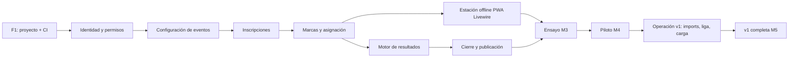

# 08 — Roadmap de construcción de TDChronos 2.0

> **Fecha:** 2026-10-19 · **Estado:** vigente · Documento de especificación de TDChronos 2.0. Equipo: **2 personas**
> (una backend y una full-stack) con apoyo puntual del organizador para validar. Iteraciones de 2 semanas con demo.
> Fechas orientativas.
> Enmienda ADR-015 (2026-10-20): arranque limpio — base de datos nueva creada íntegramente por migraciones desde cero;
> seeders con datos sintéticos; usuarios nuevos (admin bootstrap + seeders); sin conexión ni migración de datos
> heredados. No hay fase de estabilización de un sistema anterior ni corte de migración.

## 1. Principios del plan

| # | Principio | Fuente |
|---|-----------|--------|
| 1 | **Iteraciones de 2 semanas** con demo al organizador y revisión de riesgos en cada demo | — |
| 2 | **Decisiones bloqueantes resueltas antes de M1** (Q4, Q5, Q6 y Q7 del PRD — ver §4) | PRD §10 |
| 3 | **Camino crítico en la estación offline + el motor de resultados**: prototipar (espiga técnica de 3-5 días en F1) en cuanto exista el modelo de inscripciones | — |
| 4 | **Arranque limpio**: base de datos nueva creada íntegramente por migraciones desde cero; seeders con datos sintéticos; usuarios nuevos (admin bootstrap + seeders); sin conexión ni migración de datos heredados (enmienda ADR-015, 2026-10-20) | ADR-015 |
| 5 | **Monolito primero**: una sola aplicación Laravel 13 (ADR-010) con la UI dentro (ADR-011); clientes separados solo en F4 (ADR-016) | ADR-010/011/016 |
| 6 | **El margen post-F3 absorbe retrasos**: la v1 en operación (M5) no depende de ventanas de calendario; el piloto (M4) se coordina con el calendario real de carreras | — |

## 2. Fases

| Fase | Objetivo | Duración | Inicio → fin (orientativo) | Hitos |
|---|---|---|---|---|
| **F1** — Fundaciones Laravel 13 | Repositorio, Docker/CI, auth + permisos, esqueleto Livewire, Reverb, espigas de riesgo | 5 semanas | 2026-11-02 → 2026-12-04 | **M0**, **M1** |
| **F2** — MVP evento punta a punta (Livewire) | Configuración → inscripciones → salidas → estación offline PWA → meta → correcciones → clasificación en vivo → cierre; ensayo de 300 inscritos | 18 semanas | 2026-12-07 → 2027-04-09 (+1 semana de ensayo) | **M2**, **M3** |
| **F3** — v1 y operación | Imports, liga/puntos, exportaciones (PDF), piloto, operación y observabilidad | 20 semanas | 2027-04-16 → 2027-09-03 | **M4**, **M5**, **M6** |
| **F4** — v2 / plataforma SaaS | Móvil B3, visor B4 y SaaS multitenant según la documentación de plataforma del corpus de origen, en su orden propio | Continuo | Tras M5/M6 | Hitos de plataforma re-basados |

### F1 — Fundaciones Laravel 13

- **Objetivos:** base técnica completa sobre el stack decidido (ADR-010), con la UI esbozada (ADR-011) y el tiempo real
  operativo (ADR-013); riesgo técnico mayor (estación offline) prototipado.
- **Entregables:**
  - Repositorio nuevo, Docker Compose (dev/nodo de sede/VPS) con Caddy; CI con Pest, Larastan 8, Pint, gitleaks y
    Playwright `smoke` (ADR-018); `composer audit`.
  - Autenticación (Sanctum) + **roles y permisos** con spatie/laravel-permission (teams = evento) y la matriz de
    políticas probada (ISSUE-041…046); `/me` con permisos efectivos.
  - **Esqueleto Livewire**: layout del panel, login, navegación por evento (`/events/{id}/…`), componentes base
    (tablas, formularios, confirm-modal), pruebas de arquitectura (Livewire → Actions; sin `resources/js`).
  - **Reverb** operativo en dev/CI con canal de prueba y test de fallo del WS (ADR-013).
  - **Espigas** (3-5 días): estación offline PWA Livewire + IndexedDB (ADR-014) — obligatoria, con prototipo revisado
    por un cronometrador; generación PDF con dompdf (ADR-017).
  - Logs y errores estructurados (ISSUE-099).
- **Épicas/issues:** EP-03, EP-24 (ISSUE-105…118), ISSUE-041…046, 099 (más las espigas de EP-27). ~2,5 iteraciones.
- **Criterio de salida (M0):** [05-dod.md §3](05-dod.md) — CI mínimo verde, `migrate:fresh --seed` operativo con admin
  bootstrap, gitleaks verde.
- **Criterio de salida (M1):** [05-dod.md §3](05-dod.md) — `docker compose up` completo; CI íntegro; login + `/me` +
  matriz de permisos; esqueleto Livewire navegable; Reverb con test de fallo del WS; suite `smoke` en CI; espigas con informe.

### F2 — MVP: evento de punta a punta con Livewire

- **Objetivos:** operar un evento completo en el sistema nuevo, de la configuración a los resultados publicados,
  cumpliendo O1/O4/O5 en el ensayo.
- **Entregables (con ADR aplicable):**
  - Configuración: eventos y fases, carreras/distancias, categorías, oleadas y reprogramación en bloque (ISSUE-048…051).
  - Directorio: personas, organizaciones/clubes, equipos (ISSUE-055…058).
  - Inscripciones y dorsales: alta individual/equipo, unicidad, ajustes acumulables, recategorización con
    previsualización, asignación automática (ISSUE-060…062, 064…066).
  - **Tiempo real base** según ADR-013: canales por evento, `seq`, resincronización (ISSUE-084…087).
  - **Marcas y asignación** + **estación offline PWA Livewire** (ADR-014) con sync idempotente, reloj con offset y
    duplicados entre estaciones (ISSUE-067…069).
  - **Correcciones y bitácora** con marcas inmutables (ISSUE-070…071).
  - **Resultados, leaderboard y kiosco** en Livewire con canal público sin PII (ISSUE-074…076).
  - **Control de salida**: check-in con contadores reales, salida con deshacer (ISSUE-052).
  - Cierre y publicación de resultados (ISSUE-077); backups y runbook (ISSUE-101, 102).
  - Planillas de inscripción PDF (ADR-017).
- **Épicas/issues:** EP-05 (ISSUE-048…052), EP-06 (055…058), EP-07 (060…062, 064…066), EP-08 (067…071),
  EP-09 (074…077), EP-11 (084…087), EP-25 (ISSUE-119…140), EP-26 (ISSUE-141…146), EP-27 (ISSUE-147…152),
  ISSUE-101, 102. ~9 iteraciones.
- **Criterio de salida (M2):** checklist de paridad O3 al 100 % ([05-dod.md §4](05-dod.md)), DoD de pantalla cumplida
  en las 14 pantallas, backups probados. **Criterio de salida (M3):** ensayo con 300 inscritos, 4 estaciones, corte de
  red de 10 min, **0 marcas perdidas o duplicadas**, clasificación < 2 s; acta con cronometrador real.

### F3 — v1 y operación

- **Objetivos:** completar el producto v1 — importaciones, liga configurable, exportaciones — y operarlo con robustez
  (piloto, observabilidad, carga, retención). **Sin migración de datos ni corte de migración: fuera de alcance**
  (enmienda ADR-015, 2026-10-20).
- **Entregables:**
  - Importaciones Excel/CSV con vista previa y reporte (ISSUE-089…091, EP-12).
  - Liga y esquemas de puntos configurables (ISSUE-078, 081…082, EP-10); exportaciones (ISSUE-079), branding
    (ISSUE-053), duplicados (ISSUE-059), dorsales automáticos (ISSUE-063), agregación WS (ISSUE-088).
  - Métricas, prueba de carga (k6), retención (ISSUE-100, 103, 104).
  - **Piloto y operación:** primer evento real completo con el sistema nuevo; estabilización (≈ 2 eventos);
    observabilidad y mejora continua.
- **Épicas/issues:** EP-12 (ISSUE-089…091), EP-10 (081…082), ISSUE-053, 059, 063, 078, 079, 088, 100, 103, 104.
  ~10 iteraciones.
- **Criterios de salida:** **M4** — piloto sin incidencias P0 y feedback del equipo de meta; **M5** — v1 completa:
  importaciones, liga, exportaciones, prueba de carga superada y observabilidad operativa; **M6** — operación estable
  consolidada tras varios eventos reales.

### F4 — v2 / plataforma SaaS (fase posterior; ADR-016)

- **Objetivos:** ejecutar el diseño de plataforma SaaS del corpus de origen **en su orden propio**, tras la v1 del
  núcleo: multi-tenant e identidad → panel/portal/planes → pagos → app móvil y sync (B3) → visor (B4) → corte del
  tenant #1, carga, pentest y apertura GA; reconocimiento facial v2 si el informe legal lo permite.
- **Entregables:** los del backlog consolidado de plataforma (issues SAAS-100…599, épicas EP-15…EP-23) con su MVP
  (documentación de plataforma del corpus de origen), más las mejoras v2 que la plataforma no absorbe: ISSUE-047 (2FA
  panel), 054 (clonado), 072 (chips — pasa a Premium según R-d), 073 (fotos), 080 (diplomas), 083 (liga individual).
- **Criterio de salida:** hitos de plataforma re-basados al calendario real de F4 (M1 Plataforma base, M2 MVP web
  multi-tenant, M3 Cobro, M4 Ensayo móvil, M5 Visor v1, MC Corte tenant #1, MG Apertura GA, M6 Facial v2).

## 3. Camino crítico y riesgos del plan

| Riesgo | Situación en este plan | Mitigación |
|---|---|---|
| **Estación offline con Livewire** (mayor riesgo técnico) | La parte offline no puede depender de roundtrips del servidor: exige componente local Alpine + IndexedDB dentro de la PWA (ADR-014) | **Espiga obligatoria en F1** (3-5 días); prototipo revisado con un cronometrador (G14); suite E2E `estacion-offline` nocturna; escala real solo en el ensayo M3 |
| **Paridad de las 14 pantallas** | ADR-011 cambia el paradigma de UI: el riesgo es perder detalles funcionales acordados | Tabla de paridad por pantalla contra [02-srs.md §6.1](02-srs.md#6-interfaces) (DoD P1 de [05-dod.md](05-dod.md)); suites `smoke` + `cu-paridad` desde F1 |
| **Motor de resultados** (ISSUE-074) | Riesgo alto (recálculo incremental, empates, posiciones) | Reglas de empate/primera marca bloqueantes antes de M1 (§4); pruebas de propiedad sobre distribuciones sintéticas |
| Reactividad fina en pantalla TV con Livewire | El O4 (< 2 s) debe sostenerse sin descarga de colecciones completas | Eventos Livewire + Alpine + `wire:poll` selectivo; medición con k6 y en M3; `seq` para deltas (ADR-013) |
| Riesgos de negocio R1-R11 del PRD | Vigentes | PRD §8 |
| Doble trabajo por SaaS posterior (ADR-016) | `tenant_id`/UUIDv7 llegan en F4 | Mapeo ya documentado en la documentación de plataforma del corpus de origen; sin supuestos mono-tenant duros en las Actions |

## 4. Dependencias y decisiones bloqueantes

**Bloquean M1** (resolver antes del fin de F1):

| # | Decisión | Fuente | ADR que la recoge |
|---|----------|--------|-------------------|
| 1 | Relación con el sistema externo de inscripción pública (integrar / importar) | PRD Q1 | **RESUELTA (2026-10-20, enmienda ADR-015: arranque limpio sin conexión con sistemas heredados)**; la incorporación de inscripciones se hace por importación (RF-65) en v1 |
| 2 | Edad de competencia: año del evento vs. fecha exacta | PRD Q4 | Afecta a inscripciones y recategorización (F2) |
| 3 | Resolución de empates de tiempo neto | PRD Q5 | Motor de resultados (F2) |
| 4 | Llegada válida: primera o última marca; configurable por tipo de carrera | PRD Q6 | Motor de asignación (F2) |
| 5 | Resolución (décimas/centésimas) y **hora oficial** (`captured_at`) | PRD Q7 | El modelo to-be (ADR-015) y ADR-014 la proponen; falta la confirmación formal del negocio |

**Bloquean fases concretas (no el núcleo):**

| Decisión | Bloquea | Fuente |
|---|---|---|
| Fijar versión puntual de Livewire 4 / Volt y PHP en la espiga de F1 | Arranque de F1 | ADR-010/ADR-011 |
| Calendario de carreras 2027 para planificar piloto (M4) y operación de la v1 (M5/M6) | M4/M5 | Organizador |
| Disponibilidad de hardware/red de la sede para el ensayo (mini-PC/nodo, estaciones, TV) | M3 | PRD R7 |
| Visibilidad de resultados y pantallas de meta (cualquier cuenta vs. solo inscritos; enlace firmado) | F4 (portal SaaS) | Documentación de plataforma del corpus de origen (fase posterior) |
| Monedas y pasarelas del MVP SaaS (USD/VES, BCV, Stripe vs. pagos manuales) | F4 fase de pagos | Documentación de plataforma del corpus de origen |
| Informe legal de reconocimiento facial | Fase facial de F4 | SAAS-502 |

Cada decisión se registra con fecha y responsable en la demo correspondiente; si cambia algo ya decidido, se hace como
enmienda en [03-arquitectura/](03-arquitectura/).